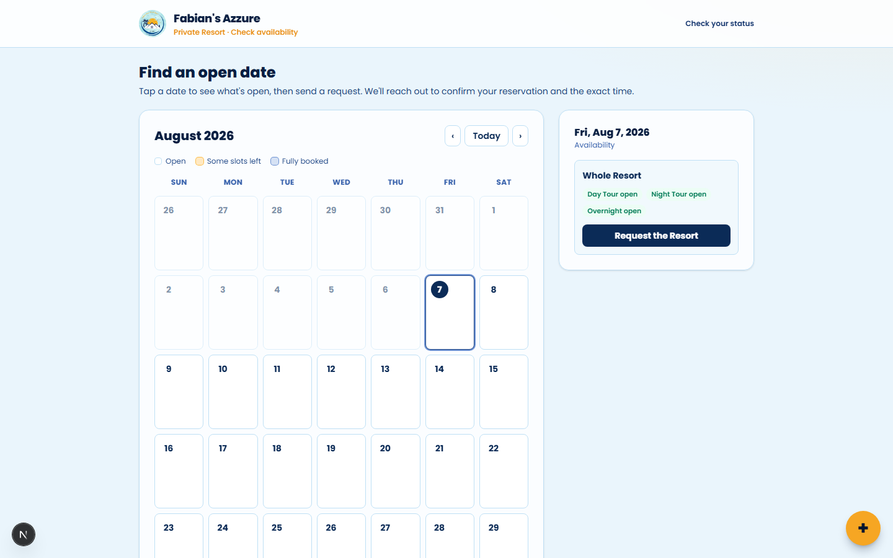
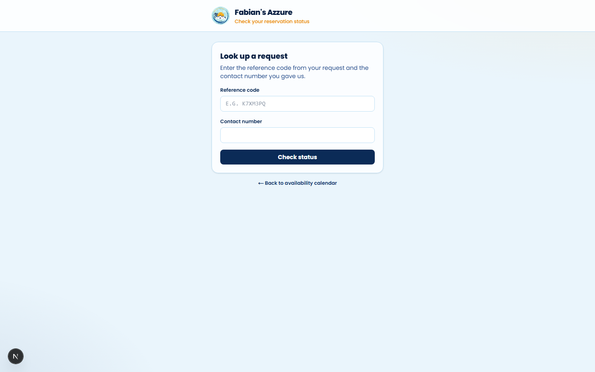
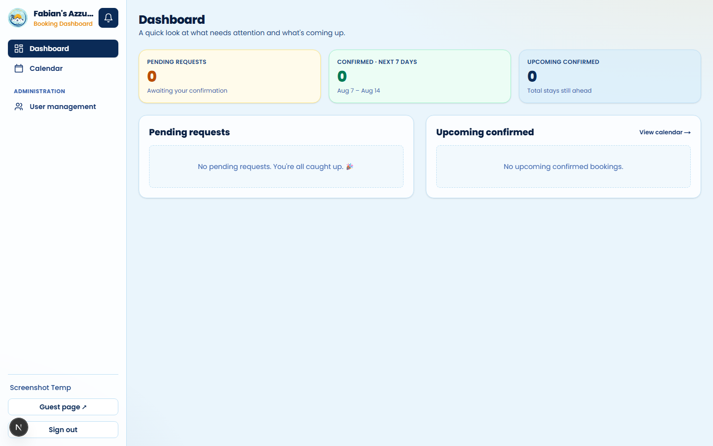
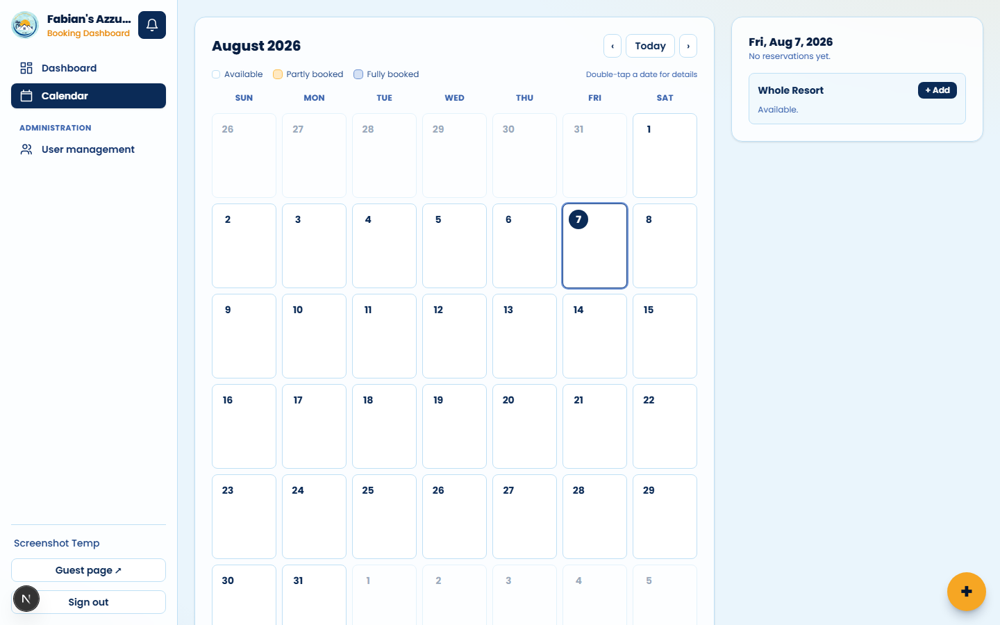

# Private Resort Booking System

A booking management platform built for a private resort that previously took reservations by hand over Messenger. Staff manage a shared calendar and confirm guest requests; guests submit booking requests through a public form and can look up their status with a reference code — no account required.

## Screenshots

| Guest booking request | Guest status lookup |
|---|---|
|  |  |

| Staff dashboard | Staff calendar |
|---|---|
|  |  |

## Why this exists

The resort offers three overlapping booking types — day tours, night tours, and overnight stays — each with different, midnight-crossing time windows, plus multi-day stays and an optional function hall add-on. Preventing double-bookings across all of that isn't a simple date-equality check: two reservations can be on "different days" and still overlap the same physical timeslot. This project's core is that scheduling logic.

## Features

- **Public booking requests** — guests submit a request (dates, slot, guest count, add-ons) without creating an account, and can track its status later with a reference code
- **Staff dashboard** — calendar view of all bookings, quick-add, request approval/decline, and exact check-in/check-out time entry once a booking is confirmed
- **Conflict-free scheduling** — bookings are modeled as absolute time intervals (not calendar-day buckets), so overlap detection works correctly across multi-day stays and slots that cross midnight
- **Role-based access** — admin vs. guest roles via NextAuth, with dashboard/booking routes restricted to admins
- **Rate limiting** on public-facing booking endpoints to curb abuse
- **Push notifications** — resort owners get a web push alert (PWA, installable) when a new booking request comes in
- **Email notifications** via Resend for booking confirmations

## Technical highlights

- **Interval-based availability engine** (`src/lib/booking.ts`): each booking's slot (day/night/overnight) maps to a default time window; once staff enter exact times, all bookings collapse to `[start, end)` intervals on a shared timeline, and conflicts are pure interval-overlap checks. This correctly handles overnight/night slots that span two calendar days. Covered by a [Vitest suite](src/lib/booking.test.ts) exercising the midnight-crossing and multi-day edge cases.
- **Two booking origins, one model**: staff-entered and guest-submitted bookings share a schema (`BookingSource: STAFF | GUEST`) with a request → confirm lifecycle (`PENDING → CONFIRMED/CANCELLED`).
- **PWA + Web Push**: installable app shell with VAPID-keyed push subscriptions per device, so owners are notified in real time without a native app.

## Tech stack

| Layer | Choice |
|---|---|
| Framework | Next.js 16 (App Router) |
| Language | TypeScript |
| UI | React 19, Tailwind CSS 4 |
| Database / ORM | PostgreSQL (Neon) via Prisma |
| Auth | NextAuth v5 |
| Email | Resend |
| Push | Web Push API (VAPID) |
